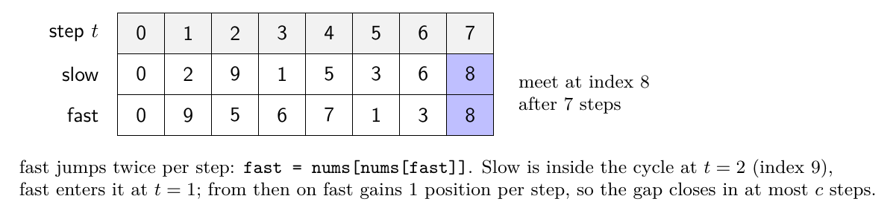
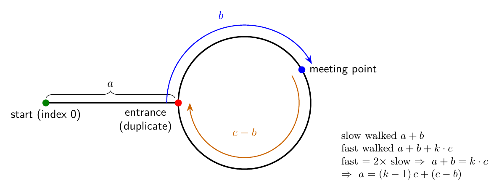
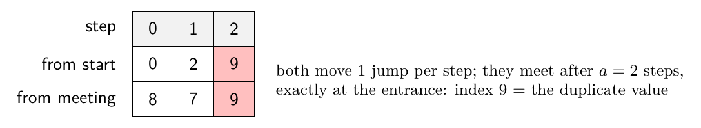
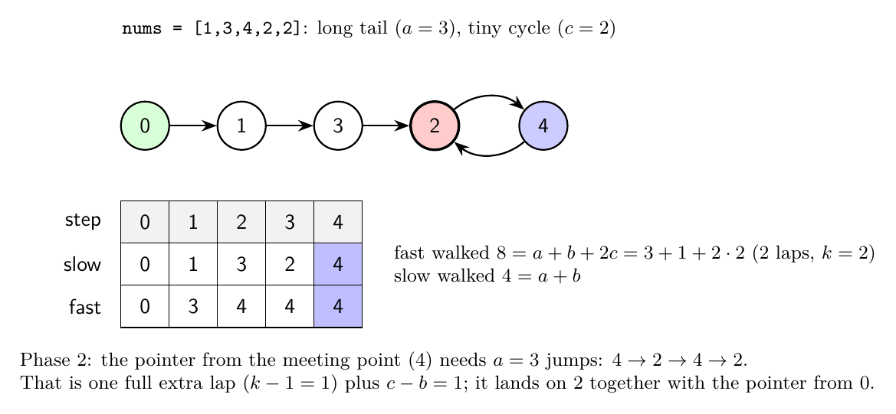

# 287 - Find Duplicate Number: Floyd's cycle detection on an array

## The constraints rule out the usual tools

- A hash set needs O(n) extra space.
- Sorting modifies the array (or needs a copy).
- Marking visited values by negating `nums[abs(x)]` modifies the array.

What is left: read-only access and a few integer variables. The trick is to stop seeing the array as a list of numbers and start seeing it as a **function** `f(i) = nums[i]` that maps indices to indices.

## Reading the array as a linked list

Every value is in `[1, n]` and there are `n + 1` slots, indices `0..n`. So every value is also a valid index. Draw an edge from each index `i` to index `nums[i]`: this is an implicit linked list where the "next pointer" of node `i` is `nums[i]`.

![Array as a functional graph: edge i to nums[i]](figures/array_to_graph.png)

Three facts follow from the value range:

1. **Every node has exactly one outgoing edge**, so following edges from any start never stops. With finitely many nodes, a walk must eventually revisit a node: there is always a cycle.
2. **No value is 0, so nothing points at index 0.** Index 0 has no incoming edge, which means it cannot sit on a cycle (a cycle node needs an incoming edge from inside the cycle). Starting at 0 guarantees a non-empty tail before the cycle.
3. **The cycle entrance is the duplicate.** The entrance is the only node with two incoming edges along the walk: one from the last tail node and one from the last cycle node. Two indices `i != j` with `nums[i] == nums[j] == x` is exactly "x appears twice". In the example, indices 2 and 7 both lead into 9.

Nodes not reachable from 0 (index 4 above) do not matter. The walk from 0 still hits a repeated value; it is just one particular pair of the indices holding it.

So the problem becomes the same one as Linked List Cycle II: **find where the cycle begins**, using two pointers instead of a visited set.

## Phase 1: slow and fast pointers meet somewhere in the cycle

```cpp
int slow = 0, fast = 0;
do {
    slow = nums[slow];          // 1 hop
    fast = nums[nums[fast]];    // 2 hops
} while (slow != fast);
```

`do/while` is needed because both start at 0 and would compare equal immediately.



Why they must meet: once both are inside the cycle, the distance from fast to slow (measured forward around the cycle) shrinks by exactly 1 every step, because fast moves 2 and slow moves 1. A gap that drops by 1 each step cannot jump over 0, so it reaches 0 within `c` steps. The meeting point is generally **not** the entrance (here it is index 8, the entrance is 9).

## The distance argument: why phase 2 works

Name the distances:

- `a` = tail length, from index 0 to the entrance
- `c` = cycle length
- `b` = distance from the entrance forward to the meeting point



When they meet, slow has walked `a + b`. Slow cannot have finished a full lap: the gap closes within one lap of slow entering the cycle. Fast has walked the same `a + b` plus some whole number of extra laps `k ≥ 1`:

```
fast = a + b + k·c
fast = 2 · slow = 2(a + b)
=> a + b = k·c
=> a = k·c - b = (k - 1)·c + (c - b)
```

Read the last line as a walk: starting at the meeting point, `c - b` steps reach the entrance, and each further `c` steps is one full lap back to the entrance. So **walking `a` steps from the meeting point ends at the entrance**, and walking `a` steps from index 0 also ends at the entrance. Nobody knows `a`, but two pointers moving at the same speed from those two places arrive at the entrance at the same moment.

## Phase 2: one pointer from the start, one from the meeting point

```cpp
int p = 0;
while (p != slow) {
    p = nums[p];
    slow = nums[slow];
}
return p;   // entrance index == duplicate value
```



In the example `a = 2`, `c = 7`, `b = 5`, `k = 1`: fast walked `14 = 2 + 5 + 7`, and `a = 0·7 + (7 - 5) = 2`.

## The extra laps: when the tail is longer than the cycle

`k` is the number of extra laps fast made before meeting slow. When the tail is long and the cycle is short, fast circles many times while slow is still in the tail, so `k` grows. The formula still holds; the pointer starting from the meeting point simply goes around the cycle `k - 1` extra times during phase 2 before the two meet at the entrance.



Here `a = 3`, `c = 2`, `b = 1`, `k = 2`. Phase 2 from the meeting point takes 3 steps: `4 → 2` (that is `c - b = 1`), then `2 → 4 → 2` (one full extra lap). The pointer from 0 goes `0 → 1 → 3 → 2`. Both are on 2 after 3 steps.

The meeting point never needs `a < c`. The only quantity the proof uses is `a ≡ c - b (mod c)`, which is true whatever `k` is.

## Why the answer is an index, not a value

Phase 2 ends with `p` equal to the entrance node, and nodes are indices. The entrance index is the duplicate because two different indices store it as their value: the duplicate value *is* the index both of them point to. That is why the function returns `p` itself and not `nums[p]`.

## Complexity

- Time O(n): phase 1 takes at most `a + c` steps, phase 2 takes `a` steps, and `a + c ≤ n + 1`.
- Space O(1): three integers. The array is only read.

## The reusable pattern

Any time a sequence is generated by repeatedly applying a function on a finite set, `x → f(x)`, it has the "rho" shape: a tail followed by a cycle. Floyd's algorithm finds the cycle start in O(1) memory without storing visited states. Examples of where the same shape shows up:

- linked list cycle detection (`f = next`)
- array-as-function problems like this one (`f(i) = nums[i]`)
- "happy number" (`f` = sum of squared digits)
- Pollard's rho factorization and pseudo-random generator period detection

The mental step is recognizing that "values are valid indices" turns an array into a functional graph, and "a value appearing twice" turns into "a node with two incoming edges", which in a walk is the cycle entrance.
